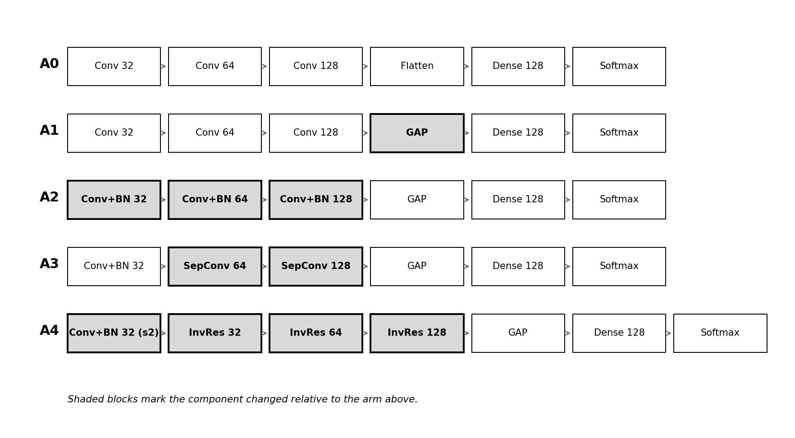
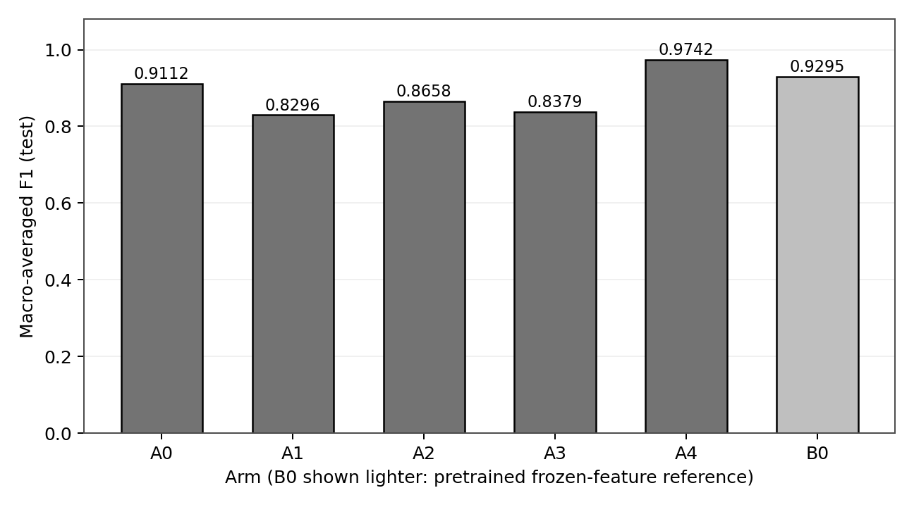
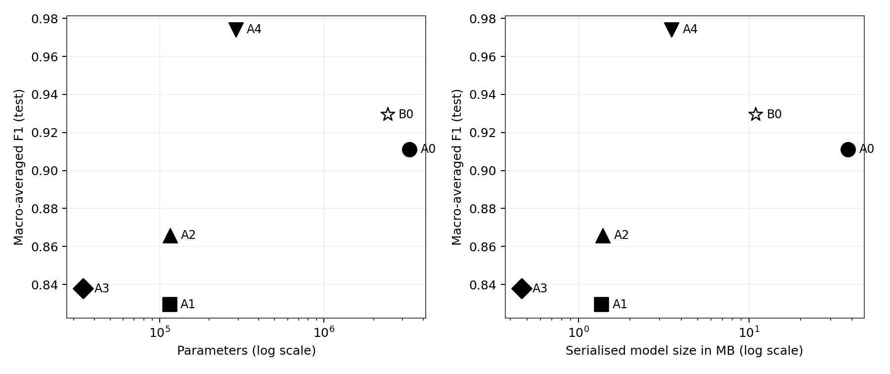
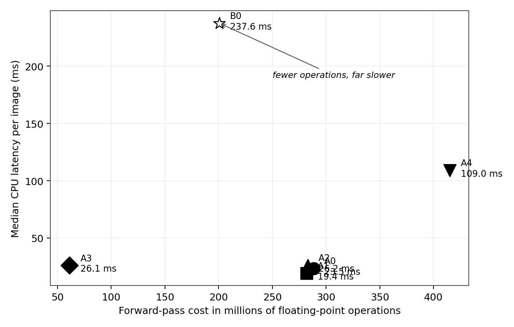
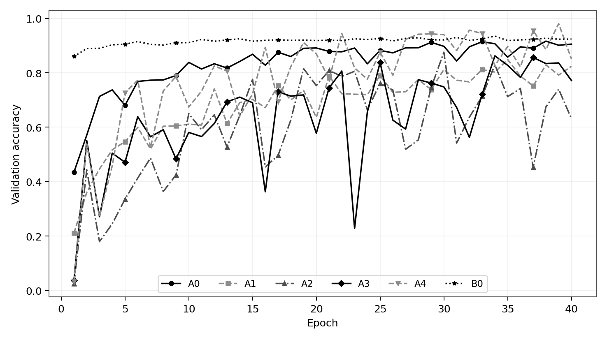

# Plant Disease Classification: Which MobileNetV2 Ideas Actually Help a Small CNN?

An ablation study on plant leaf disease classification (38 classes) with TensorFlow/Keras, done as an M.Sc. CSIT seminar project at Tribhuvan University.

A simple custom CNN is improved **one architectural change at a time**, using ideas from MobileNetV2, and each change is measured for accuracy and for cost (parameters, model size and CPU latency). A pretrained MobileNetV2 is trained under the same protocol as a reference.

**Slides:** [docs/Seminar_Presentation.pdf](docs/Seminar_Presentation.pdf)

## Key findings

- The best custom model, **A4, reached a macro F1 of 0.974** (97.9% accuracy) on 9,166 held-out test images. That is higher than the frozen pretrained MobileNetV2 reference (0.929), with **8.4× fewer parameters, 3.1× less storage and 2.2× faster CPU inference**.
- **The ideas are not additive.** Global average pooling and depthwise separable convolutions each *reduced* accuracy on their own; almost all of the gain came from **inverted residual blocks**.
- **FLOPs did not predict speed.** The pretrained MobileNetV2 needs fewer operations than the baseline but is about 10× slower per image on a CPU, so latency has to be measured on the target hardware.
- **The dataset leaks.** The published train/valid split of the dataset shares 8,599 source photographs: 62.7% of `valid/` are rotated or flipped copies of training images. This project uses its own leakage-free split, so its scores are lower than commonly reported ones, but they are honest.

## The ablation ladder

Each arm adds exactly one change to the arm before it, so the difference between neighbours measures that change.



| Arm | Change | Parameters | Size (MB) | CPU latency (ms) | Test accuracy | Macro F1 |
|---|---|---:|---:|---:|---:|---:|
| A0 | Original custom CNN (baseline) | 3,309,542 | 37.92 | 23.5 | 0.921 | 0.911 |
| A1 | A0 + global average pooling | 114,662 | 1.36 | 19.4 | 0.846 | 0.830 |
| A2 | A1 + batch normalization | 115,334 | 1.39 | 26.2 | 0.875 | 0.866 |
| A3 | A2 + depthwise separable convolutions | 34,278 | 0.47 | 26.1 | 0.861 | 0.838 |
| **A4** | **A3 + inverted residual blocks** | **289,798** | **3.52** | **109.0** | **0.979** | **0.974** |
| B0 | Pretrained MobileNetV2, frozen base (reference) | 2,426,854 | 10.90 | 237.6 | 0.933 | 0.929 |

Every arm differs significantly from the A0 baseline (McNemar's exact test, p < 0.001).







## Leakage-free splits

The [New Plant Diseases Dataset](https://www.kaggle.com/datasets/vipoooool/new-plant-diseases-dataset) (87,220 images, 14 crops, 38 classes) contains augmented copies of the same photographs, and each filename encodes its source photograph:

```
<uuid>___<CODE> <n>[_<augmentation>].JPG
```

Grouping by that ID gives only 47,032 distinct photographs, and the shipped `train/` and `valid/` folders overlap. `scripts/make_splits.py` groups files by source photograph before splitting, so no photograph appears in more than one split. Validation and test keep only original (non-augmented) photographs.

| Split | Files | Source photographs |
|---|---:|---:|
| Train | 22,800 | 16,744 |
| Validation | 4,574 | 4,574 |
| Test | 9,166 | 9,166 |

At the source-photograph level the classes range from 152 to 2,527 images (16.6× imbalance), so **macro-averaged F1** is the main metric.

## Protocol

- Input 128 × 128, batch size 64, Adam (learning rate 0.001), categorical cross-entropy
- Fixed budget of 40 epochs with no early stopping; the weights from the best validation epoch are used
- The test split is evaluated exactly once per arm, after weight selection
- Seed 42 for Python, NumPy and TensorFlow
- Trained on a Tesla T4 GPU (Kaggle); latency measured on a CPU (median of 100 runs after warm-up)



## Project structure

```
src/
├── custom_cnn.py          A0 baseline
├── transfer_mobilenet.py  B0 reference (pretrained MobileNetV2)
├── models.py              all arms A0–A4 and B0, plus the ARMS registry
└── data.py                tf.data pipeline driven by the split manifests
scripts/
├── make_splits.py         builds the leakage-free train/val/test manifests
├── train_ablation.py      trains one arm and evaluates it once on the test split
├── run_ablation.py        runs the whole ladder; completed arms are skipped
├── benchmark.py           parameters, model size, FLOPs and CPU latency
└── analyze_ablation.py    comparison table, McNemar tests, trade-off figure
app/main.py                Streamlit dashboard over the trained arms
notebooks/
└── run_ablation_colab.ipynb   self-contained GPU runner for Kaggle or Colab
output/                    results of the 40-epoch run: per-arm metrics, histories,
                           test predictions and the summary table
docs/                      presentation (PDF) and figures
```

Trained weights are not included because of their size; they can be reproduced with the steps below.

## Run it

Requires Python 3.9–3.13 (TensorFlow does not support 3.14 yet).

```bash
python -m venv venv
source venv/bin/activate          # Windows: venv\Scripts\activate
pip install -r requirements.txt
```

Download the dataset from Kaggle and extract it so that this path exists:

```
data/archive/New Plant Diseases Dataset(Augmented)/New Plant Diseases Dataset(Augmented)/train/
```

Then:

```bash
python scripts/make_splits.py --seed 42 --cap-per-class 600
python scripts/run_ablation.py --seeds 42 --epochs 40
python scripts/analyze_ablation.py --seed 42
streamlit run app/main.py
```

A single arm can be trained on its own:

```bash
python scripts/train_ablation.py --arm A4 --seed 42 --epochs 40
```

Training on a CPU is slow, so the recommended way is to open `notebooks/run_ablation_colab.ipynb` on a GPU runtime (Kaggle or Colab) and run all cells. Kaggle credentials are read from the `KAGGLE_USERNAME` and `KAGGLE_KEY` environment variables or an existing `~/.kaggle/kaggle.json`.

## Limitations

- The MobileNetV2 reference was used as a frozen feature extractor (only 7% of its parameters trainable), so a fully fine-tuned MobileNetV2 would be a stronger comparison.
- Each arm was trained with a single seed, so run-to-run variation was not measured.
- A4 was still improving at the end of the 40-epoch budget, so its score is a lower bound.
- The images are single leaves on plain backgrounds; results may not carry over to field photographs.
